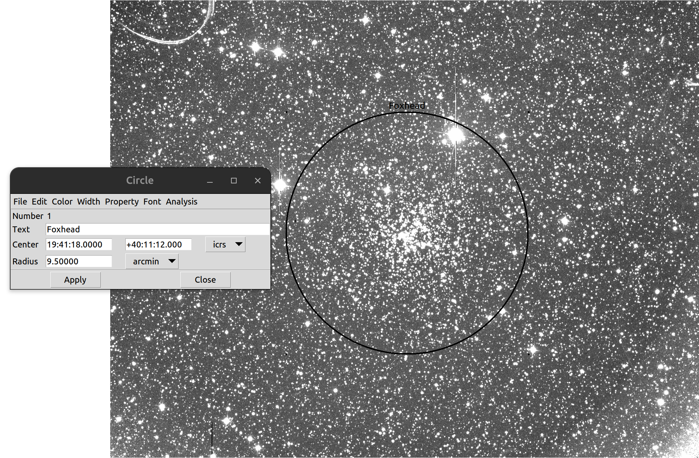
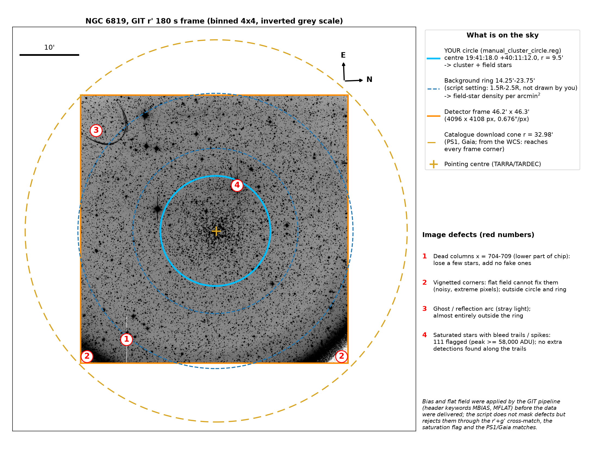

<!--
report_text.md  -  YOUR words for NGC6819_Final_Report.pdf.
The pipeline fills in every number, table, figure and code listing automatically; this file holds the
explanations, which the course rules require to be your own.

Rules
  * Sections start with a line "## key" (keep the keys).  Any section that still starts with TODO is shown
    in the PDF as a grey "to be written" box, so you can see what is missing.
  * Write numbers as placeholders so they always match the latest run, e.g. {{mu0}} or {{age_gyr_total}}.
    All available placeholders and their current values are listed in report_placeholders.txt.
  * Formatting: blank line = new paragraph, **bold**, *italic*, `code`, lines starting "- " are bullets,
    "### Heading" is a sub-heading, and a line    inserts a screenshot.
  * HTML comments like this one are ignored.
Rebuild the PDF in a few seconds with:   python ngc6819_master_pipeline.py --report-only
-->

## original_goals
<!-- Condensed from observation_report.pdf (Sections 1, 3-5); quoted phrases are verbatim. -->
- **Target:** NGC 6819, an open cluster in the Kepler field whose distance is known from eclipsing binaries, asteroseismology and Gaia parallaxes, methods that "do not converge".
- **Product:** an SDSS colour-magnitude diagram from GIT images only (g', r', i'; short and long exposures). Pan-STARRS sets the magnitude scale and Gaia decides membership; "neither contributes a point to the diagram itself".
- **Method:** PSF photometry for the crowded field, Pan-STARRS DR1 zero points, Gaia DR3 proper motions and parallaxes (about 1500 members expected).
- **Fit:** reddening, distance modulus and age "from a single simultaneous isochrone fit" (PARSEC, [Fe/H] = +0.09, R_{V} = 3.1), unresolved binaries excluded; also turnoff mass and member temperatures.
- **Verification:** every parameter checked against independent literature benchmarks (Table {{tab_plan}}).
- **Success criterion:** distance modulus within about 0.15 mag of the eclipsing-binary value, age within about 0.3 Gyr.

## data_analysis_overview
<!-- DRAFT written with Claude Code at my request (see AI declaration); reviewed and edited by me. -->
Data: one 180 s frame each in r' and g' (12 Oct 2026, airmass {{airmass_r}}, seeing {{fwhm_r}}"/{{fwhm_g}}"); the proposal's i' band and short exposures were not taken. The frames are bias- and flat-corrected by the GIT pipeline but still contain the sky ({{sky_r}} ADU in r').

**By hand (SAOImageDS9):** cluster circle, centre {{circle_centre}}, r = {{circle_radius}}', saved in ICRS so that it selects the same stars in both frames (the frames are offset by a few pixels), and a check of image defects (dead columns, vignetted corners, a stray-light arc, bleed trails), none of which fall in the circle or the background ring.

**In code** (ngc6819_master_pipeline.py, astropy/photutils), following standard crowded-field practice (DAOPHOT; Stetson 1987):

- *Sky:* photutils Background2D, 128 px mesh, σ-clipped median; its rms is the measured sky noise (1.4x the pure photon noise).
- *Detection:* DAOStarFinder at 4σ, 25 px border; default shape cuts loosened because they rejected 203 real Gaia stars.
- *PSF:* empirical ePSF (Anderson & King 2000) from {{n_psf_stars}} isolated stars spread over an 8 x 8 grid, so the PSF is not dominated by one part of the chip.
- *Photometry:* PSF fitting (9 x 9 px), needed because the field (b = 8.5 deg) is crowded. Custom step: the {{n_fallback}} brightest stars (peak > 30,000 ADU, about half saturation) use a 1.5 FWHM aperture, shifted by the measured PSF-aperture offset ({{ap_offset}} mag).
- *Positions:* each frame's own WCS; r'/g' pairs within 1" ({{n_matched}} stars, median separation 0.22").

## zero_points_and_uncertainties
<!-- DRAFT written with Claude Code at my request (see AI declaration); reviewed and edited by me. -->
**Zero points.** Standard in-field calibration against Pan-STARRS1 DR1 (Chambers et al. 2016), so airmass and throughput cancel. PS1 magnitudes were put on the SDSS system with the linear relations of Tonry et al. (2012, Table 6), then x_{SDSS} - x_{inst} = ZP + C (g-r)_{inst} was fitted with Siegel's (1982) repeated median, which is robust to blends and mismatches without a clipping threshold. Reference stars: {{n_ref}}, with 13.5 < r_{PS1} < 17.5 (PS1 saturation; Magnier et al. 2013), errors < 0.03 mag, and |PSF - Kron| < 0.05 mag to reject galaxies and blends (Chambers et al. 2016). Result: ZP_{r} = {{zp_r}} +/- {{zp_r_err}} (C = {{ct_r}}), ZP_{g} = {{zp_g}} +/- {{zp_g_err}} (C = {{ct_g}}); changing the cuts moves the zero points by <= 0.004 mag.

**Uncertainties.**

- *Per star:* measured sky noise + photon noise + DAOPHOT II's default 0.75% flat-field term (applied to the star only, as the measured sky noise already includes the sky's flat-field structure); PSF errors are scaled by √(reduced χ^{2}) when > 1.
- *Zero point:* 500 bootstrap resamples (+/-{{zp_r_err}} mag) plus an adopted {{cal_sys_floor}} mag systematic floor, the level at which photometry codes disagree (Tonry et al. 2012). The per-star scatter ({{cal_rms_r}} mag) is set by crowding, PS1 errors and a residual pattern of up to {{redd_cal_max}} mag across the chip (Figure {{fig_phase2}}c), probably flat-field related.
- *Check:* the artificial-star test (Section 2.5) shows the reported errors are about 2x too small (3-4x in the core), because the error model ignores unresolved neighbours; this is reported, not patched.

## ds9_apt_checks
<!-- DRAFT written with Claude Code at my request (see AI declaration); reviewed and edited by me. -->
A first by-eye circle (r = 4.55') and a Stellarium position both failed: Stellarium gives coordinates of date, 26 years of precession away from the J2000 frame of the image. I adopted the SIMBAD centre and the 9.5' radius of my proposal (consistent with the cluster edge at 8-9.5' of Kalirai et al. 2001) and checked it on the data: the stellar density falls from 2.8x the field level within 3' to the field level beyond about 14', so the 14.25'-23.75' background ring is field; the circle holds a 9σ over-density (Table {{tab_counts}}) and 74% of the bright Gaia members (the 4.55' circle only 35%).

## ai_declaration
<!-- DRAFT written with Claude Code at my request; edit so that it matches exactly what happened. -->
I used **Claude Code** (Anthropic) to write the analysis pipeline (photometry, calibration, membership, artificial-star test, isochrone fit, figures and this PDF generator) and to find and check the references on NASA ADS; at my request it also drafted the explanatory sections of this report, which I reviewed and edited.

My part: I chose the target, drew the circle, and made the decisions (a Gaia-free membership because Gaia selection felt like letting the catalogue do the work; fixing the error model at its source rather than using the artificial-star test as an error model; rejecting unjustified numbers; verifying every reference in a database). I went through each stage and questioned every number, and several of those questions led to the fixes in Section 3.

## fit_method
<!-- DRAFT written with Claude Code at my request (see AI declaration); reviewed and edited by me. -->
**Model.** PARSEC v1.2S isochrones (Bressan et al. 2012), [Fe/H] = +0.09 (Z = 0.0185; Bragaglia et al. 2001), 40 ages from 1.4 to 3.5 Gyr. Distance and dust are free: the isochrone is shifted by μ_{0} + A_{r'} and by E(g'-r'), with A_{r'} = 2.71 E(B-V) and E(g'-r') = 1.03 E(B-V). I derived these coefficients by integrating the Cardelli et al. (1989) and O'Donnell (1994) laws (R_{V} = 3.1) over the SDSS filter curves (SVO; Rodrigo et al. 2012, 2020) for 4800-6500 K stars, instead of the proposal's A_{r'} = 2.27 E(B-V), which is calibrated to the SFD dust map (Schlafly & Finkbeiner 2011) and not to a fitted E(B-V).

**Sample.** {{n_single}} single members; blue stragglers (r' < 14.9, g'-r' < 0.37) and binaries (0.065-0.28 mag redder than the main-sequence ridge, r' 15.5-18.5) removed. A local 25-neighbour differential-reddening correction (method of Milone et al. 2012, simplified to colour offsets) was applied, because main-sequence colours differ between zones by up to {{redd_max}} mag; it reduces the colour scatter from {{redd_sig_raw}} to {{redd_sig_corr}} mag.

**Loss (custom).** Four features, each star's distance to the nearest point of the shifted isochrone in the (g'-r', r') plane, median per feature, summed with equal weights: main sequence (r' 15.3-18.5), turnoff (14.6-15.3), subgiants ({{sgb_n}} stars) and red clump ({{rc_n}} stars). Each feature is compared only with its own evolutionary phase (PARSEC labels), otherwise red-clump stars match the nearby giant branch. Medians make the loss insensitive to leftover field stars. Grid over age x μ_{0} x E(B-V), refined with Nelder-Mead.

**Degeneracy.** Dust dims and reddens, distance only dims, so solutions slide along the reddening vector (Figure {{fig_fit}}b); the main-sequence curvature and the red-clump colour break it.

**Errors.** Statistical: 100 bootstrap resamples (Efron 1979), asymmetric 16th/84th percentiles. Systematic: refits with r' shifted by +/-0.020 and colour by +/-0.029 mag, largest change per direction in quadrature. Not included: extinction law (+/-0.03 mag in μ_{0}), [Fe/H], model choice.

**Derived.** d = 10^{(μ0/5 + 1)} pc; (m-M)_{V} = μ_{0} + 3.1 E(B-V); M_{TO} = initial mass at the bluest point of the upper main sequence (as in Brewer et al. 2016); member Teff from the nearest isochrone point, compared with Gaia DR3 GSP-Phot (Andrae et al. 2023).

## membership_comparison
<!-- DRAFT written with Claude Code at my request (see AI declaration); reviewed and edited by me. -->
Because Gaia membership lets a catalogue choose the stars, I added a Gaia-free membership by statistical field-star subtraction with the background ring (standard comparison-field method, Bonatto & Bica 2007; custom variant): each ring star, drawn with probability A_{circle}/A_{ring}, removes the nearest circle star in the CMD (within 0.2 mag in colour or 1 mag in r'); over 100 realisations stars surviving >= 50% are members ({{n_free}} stars). Gaia was used only to score the result: {{frac_stat_that_are_gaia}} of them are Gaia members.

The three samples in Table {{tab_compare}} agree within their errors: inside the same circle, (m-M)_{V} = {{mMV_gcircle}} (Gaia) and {{mMV_free}} (Gaia-free). Without Gaia the upper main sequence, turnoff and red clump survive, but only 2 subgiants remain (hence the large upper age error), and the method fails below r' of about 17.5, where the crowded circle is less complete than the ring.

## what_worked_failed
<!-- DRAFT written with Claude Code at my request (see AI declaration); reviewed and edited by me. -->
**Worked.**

- PSF photometry: unbiased to 0.02 mag down to r' = 18.5 in every zone, while aperture photometry is up to 0.15 mag too faint in the core (sky ring contaminated by neighbours), confirming the proposal's choice.
- Calibration and astrometry: zero points to +/-0.004 mag and insensitive to the cuts; Gaia matches with 0.23" median separation and 1.6% chance coincidences.
- The circle is justified by a 9σ over-density and the radial profile; membership does not drive the result (Gaia-free fit agrees); both success criteria are met.

**Failed or weak.**

- Data: no i' or short exposures, airmass 1.5, 3" seeing.
- Crowding: stars closer than 11 px (2.5 FWHM) are merged; core completeness is 18% at r' = 17-18, which is also why the count excess ({{excess_gaia}}) is below the {{members_inside}} Gaia members in the circle.
- Error bars are still about 2x too small (3-4x in the core).
- The age depends on {{sgb_n}} subgiants; in tests, dropping them moved the age to 3.1 Gyr.
- Differential reddening and the flat-field pattern ({{redd_cal_max}} mag in the calibration residuals; flats 3-6 days old) cannot be fully separated.

**Problems found along the way, and what they taught me.**

- **PSF stars from one corner.** The PSF stars were taken in file order, so all came from the vignetted bottom of the chip. Spreading them over the chip changed results by <= 0.02, but only that version is defensible.
- **Literature values must be checked against the use case, not copied.** The 0.86 dust-map factor and A_{r'} = 2.27 apply only to SFD-map reddening, the parallax offset to faint quasars, the 1.25 M_{sun} benchmark to one star, and E(B-V) = 0.16 was credited to the wrong paper. Replacing unjustified numbers (also the feature weights and axis scaling) exposed a real flaw, red-clump stars matched to the giant branch, which phase matching fixed.
- **What surprised me.** The GIT frames still contain the sky, and Stellarium gives coordinates of date rather than J2000.

## literature_comparison
<!-- DRAFT written with Claude Code at my request (see AI declaration); reviewed and edited by me. -->
All benchmarks were checked on NASA ADS (Table {{tab_bench}}); Figure {{fig_fit}} shows my fit and the published solutions on the same CMD and in the distance-reddening plane.

- **Distance: agrees.** (m-M)_{V} = {{mMV}} is 0.10 mag above the eclipsing-binary value 12.38 +/- 0.04 (Brewer et al. 2016), within my 0.15 mag criterion; μ_{0} = {{mu0}} lies between the asteroseismic values 11.85 +/- 0.05 (Basu et al. 2011) and 12.20 +/- 0.06 (Balona et al. 2013). The raw Gaia parallax distance of {{n_plx}} members, {{d_plx}} +/- {{d_plx_err}} kpc (0.01 mas floor; Vasiliev & Baumgardt 2021), agrees with d = {{d_kpc}} kpc. It is not zero-point corrected: the only offset at hand (-0.017 mas) is the median for faint quasars, which Lindegren et al. (2021) show does not apply to bright stars.
- **Reddening: in range, but low.** E(B-V) = {{ebv}} lies between 0.10, which Kalirai et al. (2001) *adopted*, and 0.160 +/- 0.007, *measured* by Anthony-Twarog et al. (2014) (my proposal wrongly credited it to Brewer et al.). Plausible causes: the adopted [Fe/H] = +0.09 (from 3 stars) against -0.06 +/- 0.04 from Anthony-Twarog et al. (a metal-poorer, bluer isochrone needs more dust), the extinction law (Schlafly & Finkbeiner 2011 prefer Fitzpatrick 1999 for SDSS colours), and the μ_{0}-E(B-V) degeneracy.
- **Age: within the criterion, on the old side.** {{age_gyr}} Gyr is 0.19 Gyr above the proposal's 2.2-2.5 Gyr. Published values are 2.21 (CMD) and 2.38 Gyr (binaries; Brewer et al. 2016, with Z = 0.015, while lower Z gives younger ages), 2.0-2.4 Gyr (Basu et al. 2011) and 2.62 +/- 0.25 Gyr (Sandquist et al. 2013). My age rests on {{sgb_n}} subgiants.
- **Turnoff mass: not like-for-like.** The proposal's 1.25 M_{sun} is a *preliminary* mass of one star (WOCS 24009 A; Brewer et al. 2016); the turnoff star WOCS 23009 A has 1.468 +/- 0.030 M_{sun} (Sandquist et al. 2013), close to my {{mto}} M_{sun}.
- **Temperatures.** Median offset from Gaia GSP-Phot {{teff_median}} K (giants {{teff_giants}} K, dwarfs {{teff_dwarfs}} K). GSP-Phot is reliable mainly for parallax/error > 20 (Andrae et al. 2023), which 96% of the giants but only 28% of the dwarfs meet, so the giants are the meaningful test.

## improvements
<!-- DRAFT written with Claude Code at my request (see AI declaration); reviewed and edited by me. -->
- **Observations:** the proposal's short exposures (red clump far from non-linearity) and i' band (a second colour separates dust from metallicity); several dithered frames at low airmass and better seeing against crowding; fresh twilight flats to test the 0.018 mag residual pattern.
- **Analysis:** iterative find-fit-subtract photometry (as DAOPHOT/ALLSTAR) to recover close companions; use the artificial-star completeness and scatter in the fit, or a Bayesian CMD fit with per-star errors; measure differential reddening along the reddening vector (Milone et al. 2012) and flag binaries near the turnoff; apply the per-star Gaia parallax zero point (Lindegren et al. 2021).
- **Systematics:** a metallicity grid ([Fe/H] = -0.06 to +0.09), the Fitzpatrick (1999) law, a second set of stellar models.
- **Other data:** spectroscopic [Fe/H] of turnoff stars; radial-velocity membership and binary flags (WIYN Open Cluster Study); an independent catalogue in the same filters (e.g. the Kepler Input Catalogue used by Balona et al. 2013) to test the zero points.

## conclusion
<!-- DRAFT written with Claude Code at my request (see AI declaration); reviewed and edited by me. -->
From two 180 s GIT frames I built a calibrated SDSS CMD of NGC 6819 with {{n_members}} Gaia members and fitted PARSEC isochrones with distance and dust free: age {{age_gyr}} ^{+{{age_gyr_hi}}}_{-{{age_gyr_lo}}} Gyr, μ_{0} = {{mu0}} ^{+{{mu0_hi}}}_{-{{mu0_lo}}} (d = {{d_kpc}} kpc), E(B-V) = {{ebv}} ^{+{{ebv_hi}}}_{-{{ebv_lo}}}, (m-M)_{V} = {{mMV}}. Both success criteria are met, the distance agrees with the Gaia parallaxes, and a Gaia-free membership gives the same result. The main remaining uncertainties are the inputs: metallicity, extinction law and the few subgiants that set the age.

